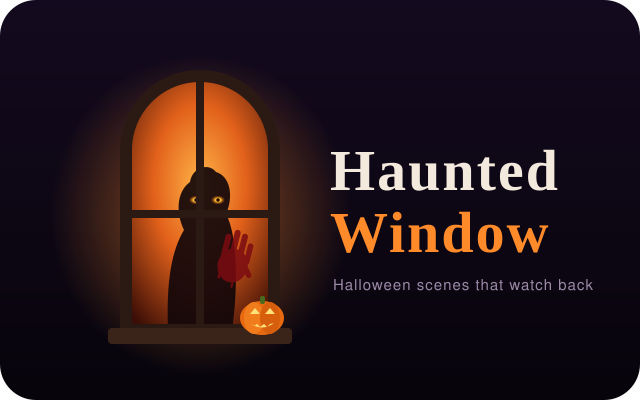

<p align="center"></p>

Halloween scenes rear-projected onto windows that notice when people walk by. A camera finds visitors on the street, and whatever is "inside" reacts to them. It runs on a Raspberry Pi 5 with one projector per window.

## Scenes

| Scene | What happens |
| --- | --- |
| **Eyes** | Giant eyes follow visitors, wake up with a voice line, and turn demonic when someone comes close. |
| **Hands** | Bloody hands slam against the glass, slide down, and leave smeared prints behind. |
| **Figure** | A woman's silhouette in a nightgown wanders behind the glass, walks to your window and tilts her head. Come too close and she rushes the glass. |
| **Pumpkins** | Two talking jack-o'-lanterns that lip-sync to the voice clips and follow visitors with their eyes. Friendly enough for daytime. |

In `auto` mode it shows pumpkins in the daytime and rotates through the scary scenes after `--scary-from` (19:00 by default).

## Our setup

- **Computer:** a Raspberry Pi 5 (2 GB) running Raspberry Pi OS. It sits indoors between the two windows and starts the show through a systemd user service.
- **Projectors:** two [Minikino mini projectors](https://minikino.no/produkter/mini-projektor) (720p, 150 ANSI lumens), one per window. Each connects to one of the Pi's two micro-HDMI ports. They stand inside the house and project onto the window glass, so the image is seen from the street. They can flip the image themselves; otherwise use `--hflip`.
- **Camera:** a Raspberry Pi Camera Module 3 Wide (about 102°×67°), mounted in the corner of a window and looking out at the street. It finds visitors by motion detection.
- **Sound:** a JBL Flip 3 Bluetooth speaker plays the voices, thuds and background music.
- **Control:** the web dashboard on port 8080, opened from a phone on the home network.

The default `--eye-x`, `--cam-height` and `--eye-height` values match our house. Measure your own windows and camera position, then set these options to match.

The Pi renders at 240p and 20 fps (`--render-height 240 --fps 20`). Both projectors are 720p, so the picture is scaled up. Because it's projected onto glass in the dark, the lower resolution isn't noticeable.

## Running

```sh
python -m venv .venv && .venv/bin/pip install -r requirements.txt
.venv/bin/python main.py --source mouse --windowed
```

`--source mouse` simulates a visitor: move the mouse in the "street" window. On the Pi, `--source picam` (the default) uses the camera module through `picamera2`, and `--source webcam` uses OpenCV.

A dashboard runs at `http://<host>:8080`. Use it to pick the scene, play sounds, trigger a scare and watch the tracker.

### Useful options

- `--eye-x A B`: window centres in metres from the camera (+ = right, as seen from the street)
- `--eye-height`, `--cam-height`, `--hfov`, `--vfov`: geometry used to place visitors
- `--window-width`: metres of window covered by one projector image
- `--hflip`: mirror the output for rear projection
- `--scene auto|eyes|hands|figure|pumpkins`

## Raspberry Pi service

```sh
rsync -av --exclude .venv --exclude settings.json --exclude __pycache__ ./ pi@raspberrypi.local:~/haunted-window/
ssh pi@raspberrypi.local 'cd ~/haunted-window && python -m venv --system-site-packages .venv && .venv/bin/pip install -r requirements.txt'
ssh pi@raspberrypi.local 'mkdir -p ~/.config/systemd/user && cp ~/haunted-window/haunted-window.service ~/.config/systemd/user/ && systemctl --user enable --now haunted-window'
```

## License

The code is MIT licensed. See [assets/CREDITS.md](assets/CREDITS.md) for the bundled images and sounds, which include one CC BY-SA 4.0 image.
